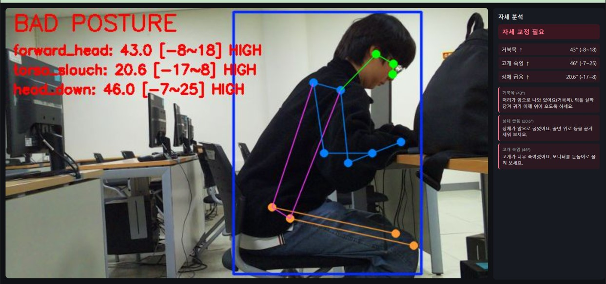

# 실시간 자세 교정 시스템 (지능형 사물인터넷)
Raspberry Pi 카메라 영상을 PC 서버로 보내 거북목·상체 굽음·고개 숙임을 실시간 판정하고 교정 메시지를 띄웁니다.

## 구조
- `라즈베리파이/main.py` : 움직임이 있을 때만 5fps로 영상 전송 (picamera2, imagezmq)
- `메인 PC/server.py` : YOLO11n-pose 추론 + Flask 웹 대시보드
- `메인 PC/analyzer.py` : 3개 각도 지표 판정, 3초 중앙값 평활화

## 실행
YOLO11n-pose 모델(yolo11n-pose.pt)을 받아 `메인 PC`에 넣은 뒤 server.py → main.py 순서로 실행